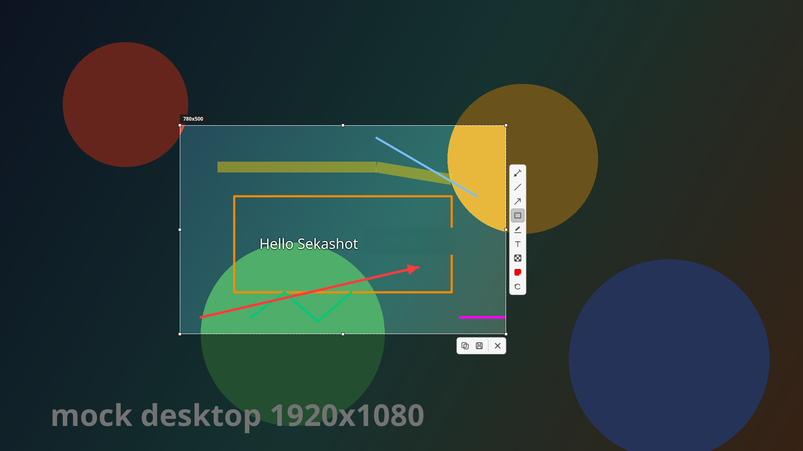

# Sekashot

A screenshot tool for Linux, inspired by [Lightshot](https://app.prntscr.com).
Python 3 + PyQt6, no compiled code of its own.

It lives in the system tray, captures the screen on **Print Screen**, freezes
the desktop behind a dimmed overlay, and lets you drag out a selection,
annotate it, then copy or save it.



## Features

- Tray app; `Print Screen` captures the screen
- Frozen, dimmed full-screen overlay with a live `W x H` readout
- Click-drag selection, 8 resize handles, arrow-key nudge, `Ctrl+A` for all
- Tools: pen, line, arrow, rectangle, marker, text, blur/redact, colour, undo
- Copy, save and close from the action toolbar
- Auto-save, shutter sound, and a notification that names the saved file
- CLI: `sekashot --capture`, `--full`, `--settings`, `--install-hotkey`

Cloud upload, share, Google Lens and print are deliberately not included.

### Image quality

Nothing is downscaled on the way out. The capture is taken at the panel's
native resolution, the selection is cropped from those original pixels, and
the result is written as PNG — lossless. An annotation only changes the pixels
it actually covers.

`tools/quality_test.py` measures this rather than assuming it: the exported
image is pixel-identical to the captured region, even when the overlay is
drawn at half size, which is what a HiDPI display does.

JPEG is offered in the settings if a smaller file matters more to you; that
one is lossy, of course.

## Install

**Debian / Ubuntu**

```bash
sudo apt install ./sekashot.deb
```

Installs `/usr/bin/sekashot`, the app under `/usr/lib/sekashot`, a menu entry,
an autostart entry and the icons.

**Any other distribution** — install PyQt6, then run it from the source tree:

```bash
sudo apt install python3-pyqt6     # Debian/Ubuntu
sudo dnf install python3-pyqt6     # Fedora
sudo pacman -S python-pyqt6       # Arch

git clone https://github.com/krisdewa/Sekashot.git
cd Sekashot && python3 -m sekashot
```

The application is pure Python and does not care which distribution it runs on.

## Linux support

Portable, but not universal: the capture backend, the global hotkey and the
tray icon all depend on the desktop environment.

| Environment | Capture | Hotkey | Tray |
|---|---|---|---|
| Wayland — niri | `grim` | `sekashot --install-hotkey`, automatic | `waybar` or similar |
| Wayland — Sway / Hyprland / River | `grim` | `sekashot --install-hotkey`, prints the line to paste | `waybar` or similar |
| Wayland — GNOME | `xdg-desktop-portal-gnome` | *Settings → Keyboard → Custom Shortcuts* | needs `gnome-shell-extension-appindicator` |
| Wayland — KDE Plasma | `xdg-desktop-portal-kde` | *Settings → Keyboard → Shortcuts* | built in |
| X11 | Qt root-window grab | grabbed by the app | depends on the desktop |

- **Wayland** needs `grim` (wlroots and scite compositors) or the desktop
  portal for your desktop. `grim` cannot work on GNOME at all, which is why the
  portal is used there.
- **X11** needs a compositing manager (Mutter, KWin, picom). Qt reads the root
  window, which only carries the visible image when a compositor draws into it;
  without one the grab comes back black, and Sekashot reports an error instead
  of showing a black screenshot.
- **The tray icon** needs a StatusNotifierItem host. GNOME has none by default —
  without it the app still works, the tray menu is just gone.

Only a `.deb` is packaged. Other distributions run it from the source tree.

## Usage

| Action | How |
|---|---|
| Take a screenshot | `Print Screen`, tray → *Take screenshot*, or `sekashot --capture` |
| Whole screen to clipboard | tray → *Full screen → clipboard*, or `sekashot --full` |
| Select a region | press and drag on the frozen screen |
| Select everything | single click without dragging, or `Ctrl+A` |
| Draw | pick a tool in the vertical toolbar, then drag |
| Blur something out | `B`, then drag over it |
| Add text | Text tool, click, type, `Enter` |
| Undo | `Ctrl+Z` |
| Copy / Save | `Ctrl+C` / `Ctrl+S` |
| Abandon | `Esc`, right-click, or the ✕ button |

### The global hotkey

Qt cannot grab system-wide keys on Wayland, so the binding comes from the
compositor.

- **X11** — the app grabs `Print Screen` itself. Nothing to do. Most desktops
  already bind `Print Screen` to their own screenshot tool; when that is the
  case the grab is refused by the X server and Sekashot falls back to
  `Alt+Print`, `Super+Print` and `Alt+Super+Print`, and says so in the
  notification.
- **Wayland** — run `sekashot --install-hotkey`. On niri it writes the config
  file and reloads it; on Hyprland, Sway and River it prints a ready-to-paste
  line; on GNOME and KDE it points at *Settings → Keyboard → Custom
  Shortcuts*. Existing bindings are respected: a key that is already taken is
  left alone and an alternative is suggested.

### Clipboard

Copy hands the PNG to `wl-copy` (Wayland) or `xclip` (X11), not only to Qt's
clipboard — a Qt selection dies when the process exits, and a keybind-spawned
capture quits straight after the action. Install `wl-clipboard` or `xclip` for
the reliable path.

## Configuration

`~/.config/sekashot/config.json`, also editable in *Settings*.

| Key | Default | Meaning |
|---|---|---|
| `save_dir` | `~/Pictures` | where Save and auto-save write |
| `save_format`, `jpg_quality` | `png`, `92` | output format |
| `auto_save` | `false` | save every capture automatically |
| `color` | `#ff0000` | default annotation colour |
| `pen_width`, `marker_width`, `marker_alpha` | `2`, `14`, `110` | stroke widths |
| `blur_radius` | `12` | blur strength in pixels |
| `font_family`, `font_size` | `Sans`, `18` | text tool |
| `dim_alpha` | `140` | background dimming |
| `capture_focused_output` | `true` | capture only the monitor under the cursor |
| `allow_black_capture` | `false` | accept a capture that comes back entirely black |
| `copy_format` | `image` | `image` or `file-url` (copy the saved path) |
| `play_sound` | `true` | shutter click |

## Troubleshooting

| Symptom | Fix |
|---|---|
| "Could not capture the screen" on Wayland | install `grim`, or the portal for your desktop (`xdg-desktop-portal-gnome` / `-kde`) |
| "The screen grab came back completely black" | no compositing manager on X11 — install `picom`, Mutter or KWin, or use a Wayland session. If your screen really is black, set `allow_black_capture` |
| `Print Screen` does nothing | on Wayland run `sekashot --install-hotkey`, then reload the compositor config. On X11 the desktop may already own the key — the notification then names the combinations that did work (`Alt+Print`, `Super+Print`) |
| No tray icon | install a StatusNotifierItem host such as `waybar`; on GNOME also `gnome-shell-extension-appindicator` |
| No shutter sound | install `python3-pyqt6.qtmultimedia` — a `paplay`/`pw-play` fallback is used when present |
| No popup after Copy / Save | needs a notification service: `python3-dbus` or `libnotify-bin` |
| Toolbar overlaps a small selection | expected — the vertical bar has a fixed height; use the arrow keys to nudge |

## Development

```bash
QT_QPA_PLATFORM=offscreen python3 tools/selftest.py       # 85 assertions

dpkg-deb -x sekashot.deb /tmp/root
PYTHONPATH=/tmp/root/usr/lib/sekashot python3 tools/integration_test.py

QT_QPA_PLATFORM=offscreen python3 tools/quality_test.py   # pixel-loss audit
QT_QPA_PLATFORM=offscreen python3 tools/preview.py /tmp/out   # render the overlay
./packaging/build.sh                                           # build the .deb
```

```
sekashot/     app.py  overlay.py  annotations.py  capture.py  hotkey.py
              config.py  settings_dialog.py  sound.py  blur.py  icons.py
packaging/    control.in  desktop entries  maintainer scripts  build.sh
tools/        selftest.py  integration_test.py  quality_test.py  preview.py
              make_icons.py
```

The design decisions behind the implementation are written up in
[CHANGELOG.md](CHANGELOG.md).

## Attribution

Sekashot is an independent re-implementation inspired by
[Lightshot](https://app.prntscr.com). It is not affiliated with, endorsed by
or sponsored by them, and "Lightshot" and "prnts.cr" are trademarks of their
respective owners.

The toolbar layout, icon order and badge format were derived from the original
product's published UI screenshots rather than guessed. That evidence is not
shipped here because it stays under its owner's copyright.

## License

MIT — see [LICENSE](LICENSE).
